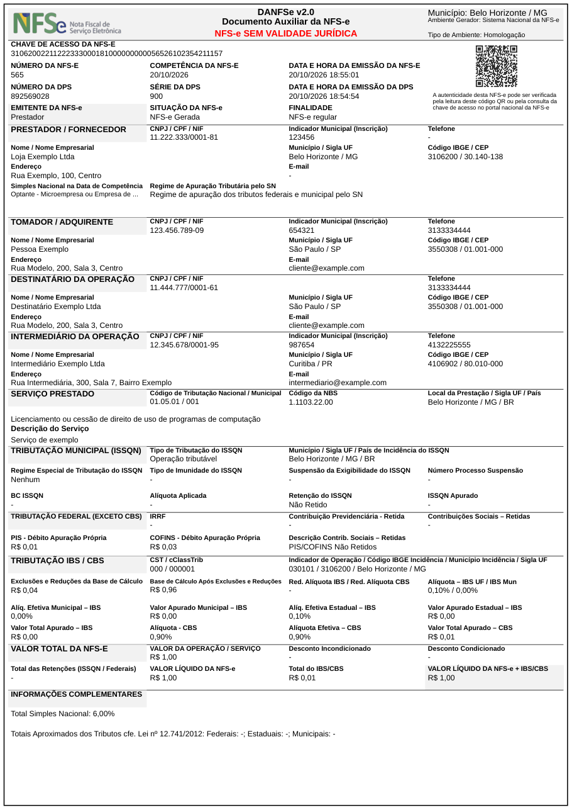

# danfse

[](https://github.com/ptec3000/danfse/actions/workflows/ci.yml)

**Gera o PDF do DANFSe a partir do XML autorizado da NFS-e Nacional**, no modelo da NT 008/2026 v1.02.

Desde agosto de 2026 a Sefin não gera mais o PDF da nota pela API (NT 008/2026): cada emissor precisa gerar o seu a partir do XML. Esta gem faz exatamente isso, em Ruby puro, sem rede e sem programas externos. Ela não emite nota nem consulta a situação da nota no portal nacional: entra o XML, sai o PDF.

> 🎲 **Testada em produção.** Gera os PDFs das notas fiscais emitidas pela [Acervo de Jogos](https://www.acervodejogos.com.br), plataforma para aluguel de jogos de tabuleiro, para as lojas e os clientes delas.

<p align="center">
  
</p>

## O que ela cobre

- Leiautes **1.00 e 1.01** da NFS-e Nacional, incluindo o grupo **IBS/CBS** da reforma tributária.
- Prestador, tomador, destinatário e intermediário, inclusive **no exterior** (com ou sem NIF).
- Retenções de ISSQN e federais, Simples Nacional, MEI, não incidência e imunidade, com as frases da NT para os blocos vazios.
- **QR code** da consulta pública, chave de acesso e ambiente (homologação sai com "NFS-e SEM VALIDADE JURÍDICA").
- Marca d'água de nota **CANCELADA** ou **SUBSTITUÍDA** e canhoto de recebimento opcional.
- Textos longos cortados com "..." sem perder os dados obrigatórios; o PDF sempre cabe em uma página.
- Linha de comando para gerar o PDF de um arquivo.

## Começo rápido

Requer Ruby 3.4 ou superior. No Gemfile:

```ruby
gem "danfse", github: "ptec3000/danfse", tag: "v0.1.2"
```

Depois, `bundle install` e:

```ruby
require "danfse"

pdf = Danfse.render(File.read("nota.xml")) # String binária com o PDF
File.binwrite("nota.pdf", pdf)
```

## Uso

```ruby
Danfse.render(xml)                                  # nota normal
Danfse.render(xml, situacao: :cancelada)            # marca d'água CANCELADA
Danfse.render(xml, situacao: :substituida)          # marca d'água SUBSTITUÍDA
Danfse.render(xml, canhoto: true)                   # com canhoto de recebimento
Danfse.render_file("nota.xml", "nota.pdf")          # lê e grava arquivos; devolve "nota.pdf"
```

- `situacao:` aceita `:normal` (padrão), `:cancelada` e `:substituida`; outro valor gera `ArgumentError`. A gem não descobre sozinha se a nota foi cancelada: quem chama informa, a partir dos dados que já tem.
- Qualquer XML inválido gera `Danfse::InvalidXml`, que herda de `Danfse::Error`.

### Em Rails

Guarde o XML que a Sefin devolve na emissão e gere o PDF na hora do download. Leva cerca de 0,2 s e não precisa guardar arquivo:

```ruby
class NotasController < ApplicationController
  def show
    nota = Nota.find(params[:id])
    pdf = Danfse.render(nota.xml, situacao: nota.cancelada? ? :cancelada : :normal)
    send_data pdf, filename: "nfse-#{nota.chave}.pdf", type: "application/pdf"
  rescue Danfse::Error => error
    redirect_to nota, alert: error.message
  end
end
```

## Linha de comando

```sh
bundle exec danfse nota.xml > nota.pdf
bundle exec danfse nota.xml nota.pdf
bundle exec danfse --cancelada --canhoto nota.xml nota.pdf
bundle exec danfse --substituida nota.xml nota.pdf
```

Sem o segundo caminho, o PDF vai para a saída padrão. `--cancelada` e `--substituida` não podem ser usadas juntas. O status de saída é 0 no sucesso, 1 para XML inválido, falha de geração ou erro de arquivo, e 64 para uso incorreto. Os erros vão para stderr, sem backtrace.

## Fontes

A NT pede Arial nos títulos e Microsoft Sans Serif no conteúdo, que não podem ser distribuídas livremente. A gem usa a **Liberation Sans**, que tem as mesmas medidas da Arial; no conteúdo, ela substitui a Microsoft Sans Serif por aproximação. Quem tiver as fontes originais pode passar os arquivos TrueType, respeitando as licenças:

```ruby
Danfse.render(xml, fonts: {
  regular: "/caminho/Microsoft-Sans-Serif.ttf",
  bold: "/caminho/Arial-Bold.ttf"
})
```

Caracteres que faltarem nessas fontes usam a Liberation Sans; se faltarem nela também, aparecem como `?`.

## Contribuindo

Pull requests são bem-vindos, principalmente com XMLs de casos que ainda não estão cobertos (sem dados reais de pessoas: troque nomes e documentos).

```sh
bundle install
bundle exec rake test             # testes
bundle exec rake render_fixtures  # gera em tmp/ o PDF de cada fixture, para conferir a olho
```

Inclua um teste que reproduza a mudança e confira os PDFs afetados. A tabela de municípios do IBGE é local, para a gem funcionar sem rede; para atualizá-la, rode `bundle exec ruby script/update_municipios` e revise o diff de `data/municipios.csv`.

## Licenças

O código é [MIT](LICENSE). Os arquivos de terceiros que vão junto mantêm as condições deles:

| Item | Condição de uso | Origem |
| --- | --- | --- |
| Liberation Sans Regular e Bold | SIL OFL 1.1 ([OFL.txt](assets/fonts/OFL.txt)) | [Liberation Fonts 2.1.5](https://github.com/liberationfonts/liberation-fonts/files/7261482/liberation-fonts-ttf-2.1.5.tar.gz) |
| Logomarca da NFS-e | Logomarca oficial do gov.br, de uso exigido pela NT 2.4.3 | [gov.br/nfse](https://www.gov.br/nfse/pt-br/biblioteca/documentacao-tecnica/logos-da-nfs-e/Logo%20-%20NFS-e%20-%20Horizontal.png/view) |
| Tabela de municípios | Dado público do IBGE | [API de localidades do IBGE](https://servicodados.ibge.gov.br/api/v1/localidades/municipios) |

<details>
<summary>Hashes SHA256 das cópias distribuídas (obtidas sem alteração em 20/10/2026)</summary>

| Arquivo | SHA256 |
| --- | --- |
| `assets/fonts/LiberationSans-Regular.ttf` | `76d04c18ea243f426b7de1f3ad208e927008f961dc5945e5aad352d0dfde8ee8` |
| `assets/fonts/LiberationSans-Bold.ttf` | `788abee4c806d660e8aee46689dd8540cd4bb98da03dcc9d171ce3efd99a9173` |
| `assets/fonts/OFL.txt` | `93fed46019c38bbe566b479d22148e2e8a1e85ada614accb0211c37b2c61c19b` |
| `assets/logo-nfse.png` | `ab57fa34887929a10ee3b9b4d666084ec9b9465e62bbcc3523b99b23ccac1063` |
| `data/municipios.csv` | `db1d0753899e0a506876711b33758056e1e38ce32cef3eab1f19fad44f3eca24` |

O CSV de municípios foi gerado por `script/update_municipios`, com 5.571 municípios.
</details>
